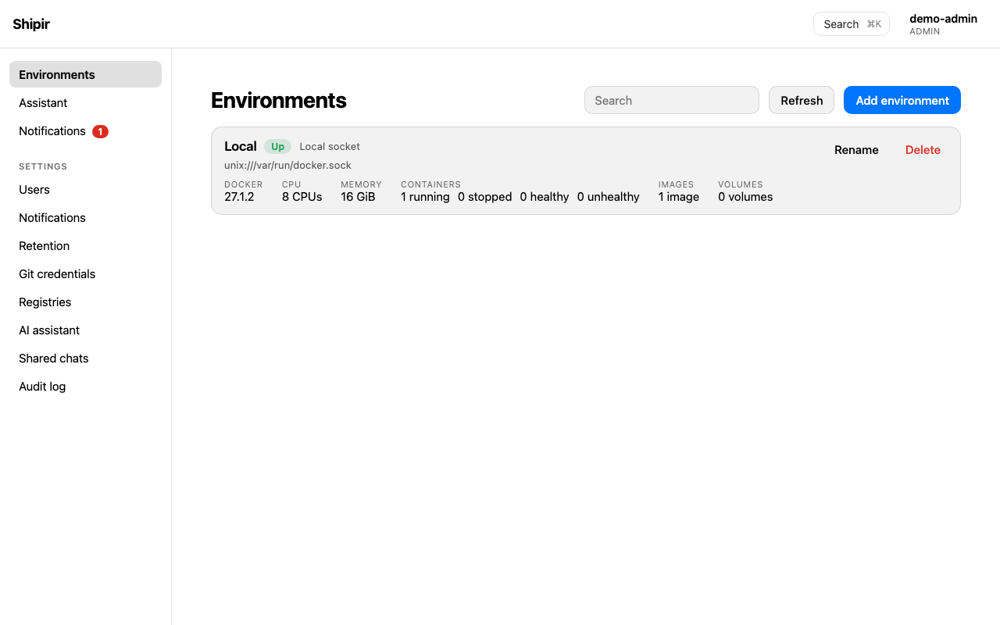
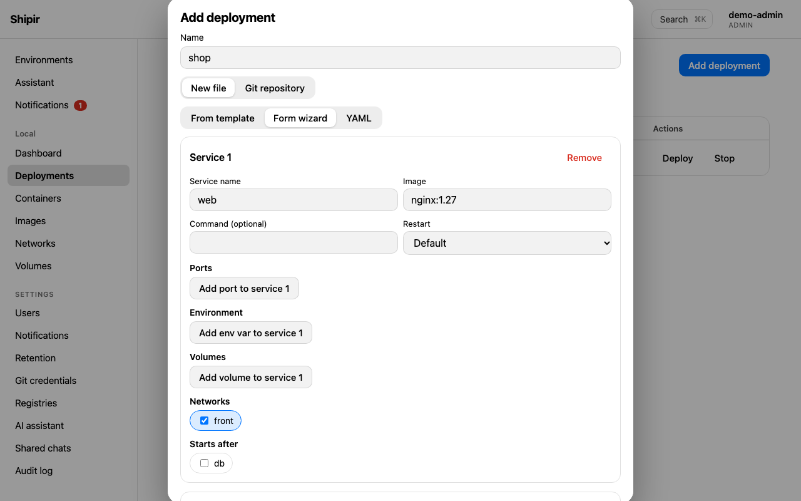
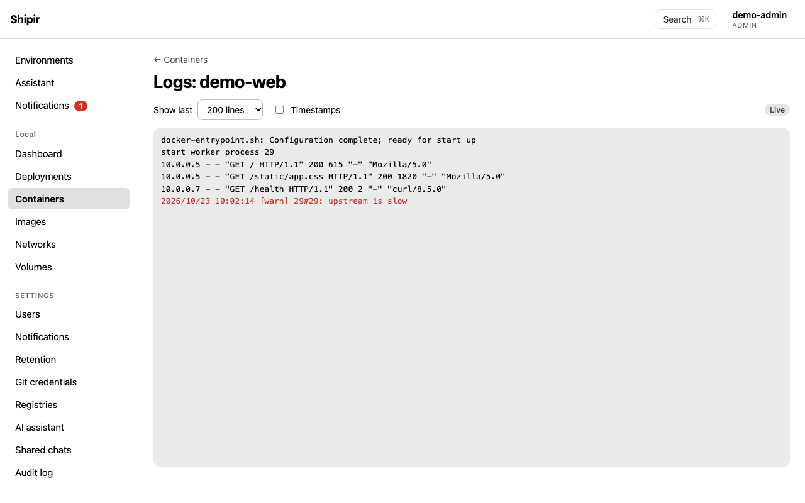
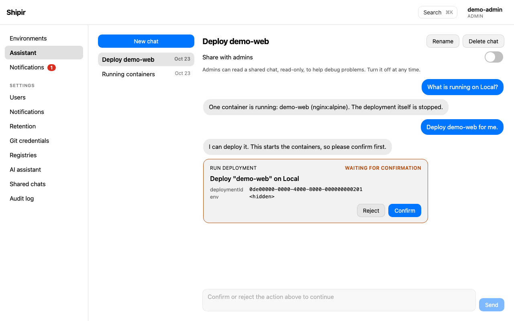

# Shipir

A web platform for managing Docker containers and Compose stacks. Think of it as a simplified Portainer, built so non-experts can use it: forms instead of mandatory YAML, with a raw editor for those who want one.

> **Status:** early development. The repo skeleton (backend + frontend) is set up; features are not implemented yet.

## Screenshots

<p align="center">
  
  
  
  
</p>

<p align="center">
  
</p>

## Why this project

This is a learning and portfolio project focused on Java backend development. The priorities are clean architecture, meaningful tests and well-reasoned decisions over feature count.

## Features (planned)

- **Containers:** list, start, stop, inspect and view stats, across one or more Docker hosts. Edit (recreated, with rollback if it fails), duplicate and change resource limits.
- **Volumes:** download a volume as a `.tar` backup, restore an archive into a volume (overlays existing files; in-use volumes need an explicit confirm; 100 MB limit, `shipir.volume-backup.max-bytes`) and schedule recurring backups with retention (stored under `shipir.volume-backup.dir`, `SHIPIR_VOLUME_BACKUP_DIR`; mount a volume there to keep them).
- **Hosts:** manage multiple Docker hosts (local Unix socket or remote TCP with TLS), with health checks.
- **Deployments (Compose projects):**
  - Create deployments from a bundled app template (nginx, postgres, wordpress, ...), with a form wizard that generates the YAML, or write it yourself in an advanced editor with schema validation.
  - Deploy, stop and pull, with live output.
  - Every deploy is versioned, so you can see history and roll back.
  - Environment variables per deployment, stored encrypted.
  - Deployments from a (private) Git repository with an access token: Pull & redeploy, and optional polling that redeploys on new commits.
- **Config editor:** edit a deployment's config files in the browser, with protection against path traversal and an automatic backup before every write.
- **Live streaming:** container logs, container stats (CPU, memory, network, disk I/O with sparklines), Docker events, Compose output and an exec terminal over WebSocket.
- **Access control:** users with roles (Admin, Operator, Viewer) plus fine-grained permissions per host and deployment.
- **API tokens and webhooks:** every user can create personal API tokens (Account) and call the API with `Authorization: Bearer shp_...`; a token acts with its owner's role and permissions, is shown once and only stored hashed. Each deployment can have a redeploy webhook (`POST /api/webhooks/deploy/<secret>`) that pulls the new images or Git changes, for CI pipelines.
- **Audit log:** a record of who did what, and when.
- **Search:** Cmd/Ctrl+K opens a command palette that finds the environments, deployments and containers you can see, and jumps to any page.
- **AI assistant:** an in-app chat (any OpenAI-compatible API, NVIDIA build by default; an admin sets the key at Settings > AI assistant) that answers from live data and acts as the signed-in user with their role. Every change waits for an explicit Confirm. Chats are saved, can be reopened, and can be shared read-only with admins for debugging.

## Upgrade notes

- **Permissions (shipr-cbw):** OPERATOR and VIEWER users only see the environments and deployments an ADMIN grants them (Settings > Users > Access). After upgrading, existing non-admin users see nothing until they are granted access.

## Tech stack

| Area | Choice |
|---|---|
| Backend | Java (current LTS), Spring Boot |
| Frontend | React, React Query, Monaco Editor |
| Database | PostgreSQL 16 with Flyway migrations |
| Docker access | [docker-java](https://github.com/docker-java/docker-java), wrapped behind the app's own interfaces |
| Compose | The `docker compose` CLI, run as a subprocess |
| Real-time | WebSocket with STOMP |
| Security | Spring Security, role-based access control |
| Testing | JUnit 5, Testcontainers, ArchUnit |

## Architecture

The backend is organized **package-by-feature** (`docker`, `host`, `compose`, `config_editor`, `streaming`, `auth`, `permission`, `audit`) rather than by technical layer. Each feature owns its entities, services, DTOs and controllers.

A few deliberate design choices:

- **Docker access goes through an abstraction.** The rest of the app never sees docker-java types. This keeps the core testable and leaves room for other connection types later, such as a remote agent.
- **Compose isn't reimplemented.** The app stores Compose files and runs the official `docker compose` CLI, streaming its output to the browser.
- **The schema is owned by Flyway**, not Hibernate (`ddl-auto: validate`).
- **Auditing is cross-cutting** and done with AOP, not repeated by hand in every service.
- **Security first.** Access to Docker is effectively root on the host, so all file access is validated against allowed base directories, subprocesses never go through a shell, and secrets are never stored in plain text or logged.

## Out of scope (for now)

- Hosted SaaS with a cloud control plane and customer-side agents
- Provisioning hosts for third parties

## Getting started

### Prerequisites

- **JDK 25** — any OpenJDK 25 distribution, e.g. [Eclipse Temurin](https://adoptium.net/).
- **Maven** — not needed locally; the Maven wrapper (`backend/mvnw`) downloads it on first use.
- **Node.js 24+** — download from [nodejs.org](https://nodejs.org) or `brew install node`.
- **pnpm 9** — run `corepack enable` to install it via corepack, or `npm install -g pnpm@9.14.4`.
- **Docker** — install [Docker Desktop](https://www.docker.com/products/docker-desktop) or Docker Engine. Needed for running containers, and **must be running for the backend tests**: they start a throwaway PostgreSQL 16 via Testcontainers (no local Postgres or `DB_PASSWORD` required).
- **git** — to clone the repository.

### Clone and build

```bash
git clone https://github.com/csSTK/shipir.git
cd shipir
```

### Local database (PostgreSQL 16)

The backend needs a local PostgreSQL. It runs in Docker via `docker-compose.dev.yml`:

```bash
cp .env.example .env                                   # then set DB_PASSWORD in .env (.env is gitignored)
docker compose -f docker-compose.dev.yml up -d         # start PostgreSQL on localhost:5432
docker compose -f docker-compose.dev.yml ps            # wait until the status shows "healthy"
```

The connection is configured with five variables, all listed in `.env.example`:

| Variable | Default | Meaning |
|---|---|---|
| `DB_PASSWORD` | none (required) | Password of the database user. Set it in `.env`, never commit it |
| `DB_HOST` | `localhost` | Host the backend connects to |
| `DB_PORT` | `5432` | Port on the host, also the published port of the container |
| `DB_NAME` | `shipir` | Database name |
| `DB_USER` | `shipir` | Database user |
| `SHIPIR_INITIAL_ADMIN_PASSWORD` | none (required on first start) | Password of the initial `admin` account, created only while the users table is empty; the admin must change it on first login. Ignored afterwards |

The compose file reads `DB_NAME`, `DB_USER` and `DB_PORT` from `.env` as well, so the container and the backend always agree.

**Port clash:** if a native PostgreSQL (e.g. Postgres.app) already listens on `127.0.0.1:5432`, it shadows the Docker database. Set `DB_PORT=5433` in `.env` and restart the container; the backend then needs `DB_PORT=5433` too (see below).

Stop the database with `docker compose -f docker-compose.dev.yml down` (add `-v` only if you want to delete the data).

### Hosting with Docker

`docker-compose.yml` runs the backend and the frontend (nginx, serving the built app and proxying `/api` and `/ws`). PostgreSQL is **not** part of this file: point the app at an existing PostgreSQL 16 server.

```bash
cp .env.example .env                                   # then set DB_PASSWORD and DB_HOST (external database) in .env
docker login ghcr.io                                   # once per host: GitHub user + token with read:packages
docker compose -f docker-compose.yml pull              # pull ghcr.io/csstk/shipir-*:${SHIPIR_TAG:-latest}
docker compose -f docker-compose.yml up -d             # app on http://localhost:${SHIPIR_PORT:-8080}
```

The images on ghcr.io are private, so `docker login ghcr.io` is required before the pull; without it, the pull fails with `unauthorized`. Use a personal access token (classic) with the `read:packages` scope as the password.

Without a pull (or when the images don't exist on ghcr.io yet), `docker compose -f docker-compose.yml build` builds both images locally, and `up` uses them.

Required in `.env`: `DB_PASSWORD`, `DB_HOST` and `DOCKER_GID`. Compose stops with a message if one is missing. On the first start (empty database) also `SHIPIR_INITIAL_ADMIN_PASSWORD`; without it the backend refuses to start. Optional: `DB_PORT`, `DB_NAME`, `DB_USER`, `SHIPIR_TAG` (image tag), `SHIPIR_PORT` (host port, default `8080`), `SHIPIR_ENCRYPTION_KEY`, `SHIPIR_HTTPS` and `SHIPIR_SECURITY_TRUSTED_PROXIES` (see below).

**First login:** sign in as `admin` with `SHIPIR_INITIAL_ADMIN_PASSWORD`. Shipir then asks for a new password (15–128 characters with upper- and lowercase letters, a digit and a symbol) before anything else is usable. Next, the admin adds the first Docker environment: the local Docker socket, or a remote Docker engine over TCP with TLS client certificates (needs `SHIPIR_ENCRYPTION_KEY`). Shipir tests the connection before saving it. Later logins skip both steps. Every user can enable two-factor authentication (TOTP app plus 10 one-time recovery codes; needs `SHIPIR_ENCRYPTION_KEY`) under Account, and login then asks for the code. Admins can reset a user's 2FA and require it for all admins (Settings > Users); admins without 2FA must then enrol before anything else. After setup, every user lands on the environments overview (status and live stats per environment); only admins can add, rename or delete environments. Clicking an environment opens its dashboard; the sidebar then lists its deployments (Compose projects), containers, images, networks and volumes for every role. Clicking a container name opens its live logs (last 100–1000 lines or all, optional timestamps, stderr highlighted) for every role. Admins and operators can delete containers (running ones only with Force), unused images, volumes and networks, and remove unmanaged deployments (`compose down`, volumes kept unless chosen). They can also pull images with live progress; Shipir checks every 6 hours (`shipir.images.update-check-interval`) whether a newer image exists in the registry and marks images, deployments and containers with 'Update available'. Viewers only read.

**Single sign-on (OIDC):** admins configure one OpenID Connect provider (Authentik, Keycloak, Entra ID, Google; authorization code + PKCE) under Settings > Single sign-on: issuer, client ID and secret (needs `SHIPIR_ENCRYPTION_KEY`), scopes, the groups claim and which groups map to ADMIN, OPERATOR and VIEWER (highest match wins, no match = login refused). Register `<public origin>/api/auth/oidc/callback` as redirect URI at the provider; the settings page shows the exact value. Behind a reverse proxy set `shipir.oidc.public-base-url` (env `SHIPIR_OIDC_PUBLIC_BASE_URL`, not yet passed through `docker-compose.yml`) to the public origin. Users are linked by issuer and subject, never by email; unknown users are created only with auto-provisioning on. Local password login can be switched off once SSO works; local ADMINs can still sign in unless `shipir.oidc.break-glass-local-admin=false`.

**Forgotten password:** the login page has a "Forgot password?" flow: enter the username, then a 6-digit one-time code (valid 5 minutes, single use, 5 attempts) and a new password. Shipir can't deliver the code yet (no mail service), so this isn't usable in a real installation until delivery is added.

**Docker socket (security):** the backend mounts `/var/run/docker.sock` to manage containers on the local Docker host. Access to the Docker socket is effectively root on the host: anyone who can control the backend can control the machine. Therefore only the frontend port is published, the backend has no published port, and the stack should run on a host that only trusted operators can reach. `DOCKER_GID` is the group that owns the socket on the host; the backend user (uid `10001`) joins it through `group_add`. Find it on a Linux host with:

```bash
stat -c %g /var/run/docker.sock                        # prints e.g. 999; put it in .env as DOCKER_GID
```

**Encryption key:** `SHIPIR_ENCRYPTION_KEY` encrypts stored TLS material (AES-256-GCM) at rest. It is optional while only the local Docker host exists. Connections to remote Docker hosts over TCP+TLS require it, and the backend refuses to start if such hosts exist without a valid key. Generate one with `openssl rand -base64 32` (it must decode to exactly 32 bytes). Store it outside git and back it up: losing it makes the stored TLS material unreadable, and changing it breaks decryption of existing data.

**HTTPS and reverse proxy:** Shipir itself speaks plain HTTP on `SHIPIR_PORT`. Put a TLS-terminating reverse proxy in front for anything beyond localhost, and set `SHIPIR_HTTPS=true` in `.env`. That turns on `Secure` for the session and `XSRF-TOKEN` cookies and sends `Strict-Transport-Security` (one year, `includeSubDomains`; browsers then refuse plain HTTP for the domain, so enable it only once HTTPS works). With `SHIPIR_HTTPS=true` the app is unusable over plain HTTP, because browsers do not store Secure cookies there (except on `localhost`). The proxy must forward WebSocket upgrades on `/ws` and send `X-Forwarded-For`. Shipir sets `Content-Security-Policy` (`default-src 'self'`, WebSocket to the same origin, `frame-ancestors 'none'`), `X-Content-Type-Options`, `X-Frame-Options`, `Referrer-Policy` and `Permissions-Policy` on every answer, static files and API alike. Caddy (certificates are fetched and renewed automatically):

```
shipir.example.com {
    reverse_proxy 127.0.0.1:8080
}
```

Traefik (labels on the `frontend` service; entrypoint and resolver names are yours):

```yaml
labels:
  - traefik.enable=true
  - traefik.http.routers.shipir.rule=Host(`shipir.example.com`)
  - traefik.http.routers.shipir.entrypoints=websecure
  - traefik.http.routers.shipir.tls.certresolver=letsencrypt
  - traefik.http.services.shipir.loadbalancer.server.port=8080
```

**Login throttling and trusted proxies:** failed logins are throttled per client address and per username. The backend only sees the address of the container in front of it, so set `shipir.security.trusted-proxies` (env `SHIPIR_SECURITY_TRUSTED_PROXIES`, comma-separated exact addresses) to the **frontend (nginx) container's address** on the compose network; then the `X-Forwarded-For` it appends is used. Without it, all clients share one address and the limit of 20 failures per 15 minutes applies to everyone together. If you put your own proxy in front of nginx, list its address too, and make sure it overwrites a client-supplied `X-Forwarded-For` or appends to it. Note that a lockout of a known username (5 failures per 15 minutes) also blocks that user's correct password until it expires. This is an accepted trade-off: it stops password guessing, at the price that someone can lock out a known username.

Only the frontend port is published. The backend is reachable only from the frontend on the compose network. The frontend starts even if the backend is not up yet; it reconnects on the next request.

Images are published to GitHub Container Registry (`ghcr.io/csstk/shipir-backend` and `ghcr.io/csstk/shipir-frontend`) by the workflows in `.github/workflows/`. A push to `dev` and every pull request runs `ci.yml`: only the tests of the changed area (`backend/`, `frontend/`), no e2e, no images. A push to `prd` runs `release.yml`: all tests and e2e, and only if they pass, the images are pushed as `latest` and `sha-<full sha>`. A `v*` tag (e.g. `v1.2.3`) runs `tag.yml`, which adds the semver tags (`1.2.3`, `1.2`, `1`; no `major` tag for `v0.x`) to the tested `sha-<commit>` image without rebuilding. Set `SHIPIR_TAG` to pick one.

Branches: `dev` is the default branch where all work lands. `prd` holds released versions and only ever fast-forwards to a `dev` commit. Release: `git push origin dev:prd`, wait until `release.yml` is green, then push the `v*` tag on that commit. If `tag.yml` failed because the image did not exist yet, re-run it with `gh run rerun <id>`.

Deployment files live in the named volume `shipir-stacks`, mounted at `/data/stacks` in the backend (`SHIPIR_STACKS_BASE_DIR`, set in the image). The backend image includes the `docker compose` CLI, which runs as the app user (uid `10001`) and uses the same mounted Docker socket.

Stop the stack with `docker compose -f docker-compose.yml down`. This does not touch the external database or the `shipir-stacks` volume. Only `down -v` deletes the stack files.

### Demo (public credentials, never for real use)

`docker-compose.demo.yml` runs a throwaway stack: PostgreSQL, backend and frontend, with the Spring profile `demo` active. The profile loads seed data (`backend/src/main/resources/db/testdata/`, a repeatable Flyway migration) into the empty database: one user per role, one LOCAL environment, a sample deployment `demo-web` (stopped, not yet deployed) and a few notifications and audit entries.

| User | Password | Role |
|---|---|---|
| `demo-admin` | `Demo-Admin-2026!` | ADMIN |
| `demo-operator` | `Demo-Operator-2026!` | OPERATOR (operate on the demo environment) |
| `demo-viewer` | `Demo-Viewer-2026!` | VIEWER (view only) |

These passwords and the database password in the demo compose file are **public**. Anyone who can reach a demo instance can sign in with them. Do not run the demo profile on an instance with real users, and do not reuse these passwords anywhere. Without the `demo` profile no seed data is applied.

```bash
DOCKER_GID=$(stat -c %g /var/run/docker.sock) docker compose -f docker-compose.demo.yml up --build   # app on http://localhost:8080
docker compose -f docker-compose.demo.yml down -v      # stops the stack and deletes its volumes (database and stack files)
```

`DOCKER_GID` is required as in the hosting stack (see the Docker socket note above); set it in `.env` or inline. The demo uses the same socket mount, so it has the same root-equivalent access to the host.

### Backup & restore

A backup has two parts: the PostgreSQL database (users, environments, permissions, audit log, notifications, deployment records and their encrypted secrets) and the `shipir-stacks` volume (stack files, `.env` files, Git checkouts, config-file backups). Both are needed for a complete restore.

```bash
scripts/backup.sh                       # writes backups/shipir-<UTC time>/ (database.dump, stacks.tar.gz, MANIFEST)
```

The database is external, so `pg_dump` runs on your machine with the PostgreSQL 16 client tools (`pg_dump`, `pg_restore`, `psql`) and connects to `DB_HOST`, like the backend. The script also needs Docker and `openssl`, and reads `DB_*` and `SHIPIR_ENCRYPTION_KEY` from `.env` (it never runs `.env` as code). The backend container must exist (`docker compose -f docker-compose.yml create backend`), but it does not need to run. Without a stop, a stack deployed during the backup may be in the dump but not in the files; stop the backend first (`docker compose -f docker-compose.yml stop backend`) for a fully consistent copy.

The backup is not encrypted and holds the stack `.env` files in plain text, so treat it like a secret: keep it out of git and off shared disks.

**The encryption key.** `SHIPIR_ENCRYPTION_KEY` is not stored in the backup. It is needed for the values the database keeps encrypted: TLS material of TCP hosts, Git and registry credentials, webhook URLs and AI API keys. Keep the key in a password manager, separate from the backups. Losing it has these consequences:

- The database and the stack files still restore, but the encrypted values are unreadable for good. Re-entering them is the only way back.
- With TCP+TLS hosts present, the backend refuses to start without the key. With a different key, decryption fails (`DECRYPTION_FAILED`); without one, features show `ENCRYPTION_KEY_MISSING`.
- `scripts/backup.sh` stores only a SHA-256 fingerprint of the key in `MANIFEST`, and `scripts/restore.sh` refuses to run with a key that does not match it.

**Restore into an empty database.** Restore only onto a fresh, empty database and an empty `shipir-stacks` volume. The script refuses otherwise. A backend that has already started on the database has run Flyway and must not be used.

1. Create an empty PostgreSQL 16 database and user, and point `DB_*` in `.env` at it. Set `SHIPIR_ENCRYPTION_KEY` to the original key.
2. Create the backend container without starting it: `docker compose -f docker-compose.yml create backend`.
3. Run `scripts/restore.sh backups/shipir-<UTC time>` and type `RESTORE` when asked. The script stops the backend, restores the database with `pg_restore`, then unpacks the stacks into the volume. It never removes a volume.
4. Start the stack: `docker compose -f docker-compose.yml up -d`. Flyway checks the restored schema history on startup.

ADMINs can also download an encrypted export from Settings > Backup. That feature is separate from these scripts, and restoring still follows the procedure above.

What the export contains:
- `manifest.json`
- one `db/<table>.jsonl` per table. Secrets stay encrypted, and password hashes are included.
- the `stacks/` directory

The file is an `openssl enc` stream: AES-256-CBC, with the key derived from the passphrase by PBKDF2-SHA256 at 600000 iterations. A 40-byte integrity trailer follows it. This is an 8-byte salt and then an HMAC-SHA256 over everything before the trailer.

To open an export, check the trailer first, then decrypt. This needs OpenSSL 3 or newer. The `openssl` that ships with macOS (LibreSSL) can't do it, so install Homebrew OpenSSL there:

```bash
export SHIPIR_BACKUP_PASSPHRASE='...'
F=shipir-backup-<ts>.tar.gz.enc
N=$(( $(wc -c < "$F") - 40 ))
MACSALT=$(tail -c 40 "$F" | head -c 8 | od -An -tx1 | tr -d ' \n')
WANT=$(tail -c 32 "$F" | od -An -tx1 | tr -d ' \n')
MACKEY=$(openssl enc -aes-256-cbc -pbkdf2 -iter 600000 -md sha256 -S "$MACSALT" -P -pass env:SHIPIR_BACKUP_PASSPHRASE | sed -n 's/^key=//p')
GOT=$(head -c "$N" "$F" | openssl dgst -sha256 -mac HMAC -macopt hexkey:"$MACKEY" -r | cut -d' ' -f1)
[ "$GOT" = "$WANT" ] || { echo "MAC mismatch: wrong passphrase or corrupted file" >&2; exit 1; }
mkdir -p restore-dir
head -c "$N" "$F" | openssl enc -d -aes-256-cbc -pbkdf2 -iter 600000 -md sha256 -pass env:SHIPIR_BACKUP_PASSPHRASE | tar -xzf - -C restore-dir
```

There is no import script for the JSONL tables yet. For a full restore, use `scripts/backup.sh` / `scripts/restore.sh`.

### Backend (Java 25, Spring Boot 4.1.1)

```bash
./backend/mvnw -f backend/pom.xml verify          # Compile and run tests
```

To run the app against the local database, export the variables from `.env` into your shell first. The Spring app does not read `.env` itself:

```bash
set -a; source .env; set +a                       # export all variables from .env (bash/zsh)
./backend/mvnw -f backend/pom.xml spring-boot:run # Run the app on http://localhost:8080 (runs Flyway migrations)
```

In fish, `source .env` fails on the `KEY=value` lines. Export them like this instead (values without quotes, fish would keep them):

```fish
for line in (string match -rv '^\s*(#|$)' < .env); set -gx (string split -m 1 = $line); end
```

Tests don't need these variables: they start their own throwaway PostgreSQL via Testcontainers.

The backend is organized package-by-feature under `backend/src/main/java/dev/bethge/shipir/`.

### Frontend (React + TypeScript + Vite)

```bash
cd frontend

# Install dependencies
pnpm install

# Run the dev server (http://localhost:5173)
# The frontend proxies /api requests to http://localhost:8080 and WebSocket /ws to ws://localhost:8080
pnpm dev

# Run tests once
pnpm test

# Run tests in watch mode
pnpm test:watch

# Build for production
pnpm build

# Lint with oxlint
pnpm lint

# One-time: install the Chromium browser used by the e2e tests
pnpm exec playwright install chromium

# Run the Playwright e2e tests (in e2e/, with /api mocked)
pnpm e2e

# Run the e2e tests in Playwright's UI mode
pnpm e2e:ui
```

### Repository layout

```
shipir/
├── backend/                          # Java backend (Spring Boot)
│   ├── mvnw, .mvn/                   # Maven wrapper
│   ├── pom.xml                       # Maven configuration (groupId: dev.bethge, artifactId: shipir)
│   └── src/main/java/dev/bethge/shipir/  # Organized package-by-feature
├── frontend/                         # React + TypeScript + Vite
│   ├── src/app/                      # Root, providers, React Query client
│   ├── src/features/                 # Feature folders (containers, hosts, stacks)
│   ├── src/shared/                   # Shared (api, ui, lib)
│   └── e2e/                          # Playwright e2e specs; fixtures/api.ts mocks /api
├── README.md                         # This file
├── CLAUDE.md                         # Development rules and architecture
└── HANDOFF.md                        # Planning context
```

### Tasks

Tasks are tracked with [beads](https://github.com/steveyegge/beads). Run `bd ready` to see available work, or see [`CLAUDE.md`](CLAUDE.md) for agent-specific instructions.

